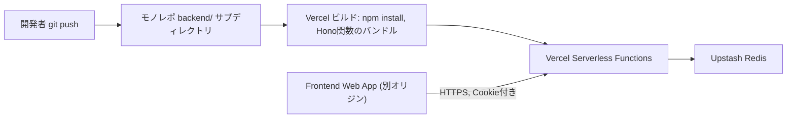

# Deployment Architecture: Backend Sync API

## デプロイフロー



### Text Alternative (fallback)
```
開発者がgit pushする
→ モノレポのbackend/サブディレクトリに対してVercelが自動ビルド
→ Vercel Serverless Functionsとしてデプロイ
→ 実行時にUpstash Redisへ読み書き
→ Frontend Web App（別オリジンのVercelプロジェクト）からHTTPS+Cookie付きでアクセスされる
```

## 環境変数
`infrastructure-design.md`の表を参照。全てVercelプロジェクトのEnvironment Variables設定で管理し、コードやリポジトリには含めない。

## CI/CDパイプラインの整合性（SECURITY-10, SECURITY-13）
- VercelのGit連携による自動ビルドを使用
- 依存関係は`package-lock.json`でバージョン固定
- デプロイ権限はGitリポジトリへのpush権限を持つ本人のみ

## ロールバック
- Vercelのデプロイ履行履歴から直前のデプロイに即座にロールバック可能

## セットアップ手順（初回のみ）
1. Vercelで`backend/`を新規プロジェクトとして作成し、Upstash Redis統合を追加
2. `FRONTEND_ORIGIN`環境変数にUnit 1のデプロイ済みURLを設定
3. ローカルから`backend/scripts/create-account.ts`を一度だけ実行し、本人のアカウントをUpstash Redisに作成する
