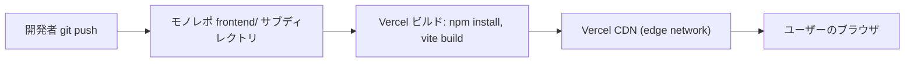

# Deployment Architecture: Frontend Web App

## デプロイフロー



### Text Alternative (fallback)
```
開発者がgit pushする
→ モノレポのfrontend/サブディレクトリに対してVercelが自動ビルド（npm install, vite build）
→ ビルド成果物（静的HTML/JS/CSS）をVercelのCDN edge networkに配信
→ ユーザーのブラウザがHTTPS経由でアクセス
```

## 環境変数
- `VITE_BACKEND_API_URL`: Backend Sync APIのベースURL（Unit 2デプロイ後に確定し、Vercelの環境変数に設定）。クライアント側で使われるためビルド時に埋め込まれる（Viteの`VITE_`プレフィックス変数）。シークレット情報は含まない
- フロントエンドは認証情報（パスワード等）やAPIキーを保持しない（認証はバックエンド発行のhttpOnly Cookieに一任、SECURITY-12準拠）ため、フロントエンド側にシークレットの環境変数は存在しない

## CI/CDパイプラインの整合性（SECURITY-10, SECURITY-13）
- VercelのGit連携による自動ビルドを使用し、ビルド環境はVercelが管理するマネージド環境（固定されたNode.jsバージョンを`package.json`の`engines`で指定）
- 依存関係は`package-lock.json`でバージョン固定し、Vercelのビルド時に`npm ci`相当のクリーンインストールを行う
- デプロイ権限はGitリポジトリへのpush権限を持つ本人のみ（単独開発者のため、追加のデプロイ承認フローは設けない）

## ロールバック
- Vercelは各デプロイのプレビュー/本番履行履歴を保持するため、問題発生時は直前のデプロイに即座にロールバック可能（Vercel標準機能）
