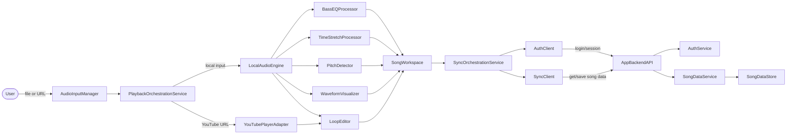

# Component Dependencies: 耳コピ補助アプリ

## 依存関係マトリクス

| コンポーネント | 依存先 | 通信パターン |
|---|---|---|
| PlaybackOrchestrationService | AudioInputManager, PlaybackSource実装群, BassEQProcessor, TimeStretchProcessor, PitchDetector, WaveformVisualizer, LoopEditor, SongWorkspace | 直接呼び出し（フロントエンド内、同期/非同期混在） |
| AudioInputManager | （なし、入力判定のみ） | - |
| LocalAudioEngine | Web Audio API（ブラウザ標準機能） | 直接呼び出し |
| YouTubePlayerAdapter | YouTube IFrame Player API（外部、公式埋め込み） | コールバック/イベント |
| BassEQProcessor | LocalAudioEngine | 直接呼び出し（音声グラフへの接続） |
| TimeStretchProcessor | LocalAudioEngine | 直接呼び出し（音声グラフへの接続） |
| PitchDetector | LocalAudioEngine | 直接呼び出し（AnalyserNode経由） |
| WaveformVisualizer | LocalAudioEngine | 直接呼び出し（AudioBuffer/AnalyserNode経由） |
| LoopEditor | PlaybackSource（インターフェース経由、実装は問わない） | 直接呼び出し |
| SongWorkspace | AudioInputManager, PlaybackSource, 各プロセッサ, LoopEditor | 直接呼び出し（集約） |
| SyncOrchestrationService | AuthClient, SyncClient, SongWorkspace | 直接呼び出し |
| AuthClient | AppBackendAPI（HTTP） | HTTP API呼び出し |
| SyncClient | AppBackendAPI（HTTP） | HTTP API呼び出し |
| AppBackendAPI | AuthService, SongDataService | 直接呼び出し（同一サービス内） |
| AuthService | （セッションストア、技術選定はNFR Requirements/Infrastructure Designで決定） | - |
| SongDataService | SongDataStore | 直接呼び出し |
| SongDataStore | データベース（技術選定はInfrastructure Designで決定） | DBクライアント呼び出し |

## データフロー図



### Text Alternative (fallback)
```
User -> AudioInputManager -> PlaybackOrchestrationService
  -> (local) LocalAudioEngine -> BassEQProcessor, TimeStretchProcessor, PitchDetector, WaveformVisualizer, LoopEditor
  -> (YouTube) YouTubePlayerAdapter -> LoopEditor
  -> all feed into SongWorkspace
SongWorkspace -> SyncOrchestrationService -> AuthClient, SyncClient -> AppBackendAPI -> AuthService, SongDataService -> SongDataStore
```

## 結合度に関する注記
- フロントエンドの音声処理コンポーネント（EQ/TimeStretch/Pitch/Waveform）はLocalAudioEngineにのみ依存し、YouTubePlayerAdapterには依存しない（疎結合、Story 2・3・4・5・6の機能差を反映）
- UI層やSongWorkspaceはPlaybackSourceインターフェースのみに依存し、具体的な実装（Local/YouTube）を知らない（Strategyパターンによる疎結合）
- バックエンドはAppBackendAPIを単一の境界とし、外部（フロントエンド）からはAuthService/SongDataServiceの内部構造を直接参照しない
