# Execution Plan: 耳コピ補助アプリ（Bass Ear-Copy Assistant）

## Detailed Analysis Summary

### Transformation Scope
Greenfield project（既存コードなし）。該当なし（Brownfield専用セクション）。

### Change Impact Assessment
- **User-facing changes**: Yes — アプリ全体が新規ユーザー向け機能（8本のユーザーストーリー全て）
- **Structural changes**: Yes — フロントエンド（音声処理/UI）とバックエンド（認証・クラウド同期）からなる新規アーキテクチャ
- **Data model changes**: Yes — 曲（ファイル/YouTube URL）、ループ区間、メモ、ユーザーアカウントの新規データモデル
- **API changes**: Yes — 認証API、曲ごとのループ/メモ保存・同期API（新規）
- **NFR impact**: Yes — パフォーマンス（ブラウザ上でのリアルタイム音声処理）、セキュリティ（Security Baseline拡張を有効化済み）

### Risk Assessment
- **Risk Level**: Medium — 新規プロジェクトで本番ユーザーはいないが、複数コンポーネント（音声DSP＋認証・同期バックエンド）があり、ピッチ検出やタイムストレッチの精度に技術的不確実性がある
- **Rollback Complexity**: Easy（本番運用前の個人用ツール）
- **Testing Complexity**: Moderate（音声処理の自動テスト＋実際に聴いての確認が必要）

## Workflow Visualization

```mermaid
flowchart TD
    Start(["User Request"])

    subgraph INCEPTION["INCEPTION PHASE"]
        WD["Workspace Detection<br/><b>COMPLETED</b>"]
        RA["Requirements Analysis<br/><b>COMPLETED</b>"]
        US["User Stories<br/><b>COMPLETED</b>"]
        WP["Workflow Planning<br/><b>IN PROGRESS</b>"]
        AD["Application Design<br/><b>EXECUTE</b>"]
        UG["Units Generation<br/><b>EXECUTE</b>"]
    end

    subgraph CONSTRUCTION["CONSTRUCTION PHASE"]
        FD["Functional Design per unit<br/><b>EXECUTE</b>"]
        NFRA["NFR Requirements per unit<br/><b>EXECUTE</b>"]
        NFRD["NFR Design per unit<br/><b>EXECUTE</b>"]
        ID["Infrastructure Design per unit<br/><b>EXECUTE</b>"]
        CG["Code Generation per unit<br/><b>EXECUTE</b>"]
        BT["Build and Test<br/><b>EXECUTE</b>"]
    end

    subgraph OPERATIONS["OPERATIONS PHASE"]
        OPS["Operations<br/><b>PLACEHOLDER</b>"]
    end

    Start --> WD
    WD --> RA
    RA --> US
    US --> WP
    WP --> AD
    AD --> UG
    UG --> FD
    FD --> NFRA
    NFRA --> NFRD
    NFRD --> ID
    ID --> CG
    CG -->|Next Unit| FD
    CG --> BT
    BT -.-> OPS
    BT --> End(["Complete"])

    style WD fill:#4CAF50,stroke:#1B5E20,stroke-width:3px,color:#fff
    style RA fill:#4CAF50,stroke:#1B5E20,stroke-width:3px,color:#fff
    style US fill:#4CAF50,stroke:#1B5E20,stroke-width:3px,color:#fff
    style WP fill:#4CAF50,stroke:#1B5E20,stroke-width:3px,color:#fff
    style AD fill:#FFA726,stroke:#E65100,stroke-width:3px,stroke-dasharray: 5 5,color:#000
    style UG fill:#FFA726,stroke:#E65100,stroke-width:3px,stroke-dasharray: 5 5,color:#000
    style FD fill:#FFA726,stroke:#E65100,stroke-width:3px,stroke-dasharray: 5 5,color:#000
    style NFRA fill:#FFA726,stroke:#E65100,stroke-width:3px,stroke-dasharray: 5 5,color:#000
    style NFRD fill:#FFA726,stroke:#E65100,stroke-width:3px,stroke-dasharray: 5 5,color:#000
    style ID fill:#FFA726,stroke:#E65100,stroke-width:3px,stroke-dasharray: 5 5,color:#000
    style CG fill:#4CAF50,stroke:#1B5E20,stroke-width:3px,color:#fff
    style BT fill:#4CAF50,stroke:#1B5E20,stroke-width:3px,color:#fff
    style OPS fill:#BDBDBD,stroke:#424242,stroke-width:2px,stroke-dasharray: 5 5,color:#000
    style INCEPTION fill:#BBDEFB,stroke:#1565C0,stroke-width:3px,color:#000
    style CONSTRUCTION fill:#C8E6C9,stroke:#2E7D32,stroke-width:3px,color:#000
    style OPERATIONS fill:#FFF59D,stroke:#F57F17,stroke-width:3px,color:#000
    style Start fill:#CE93D8,stroke:#6A1B9A,stroke-width:3px,color:#000
    style End fill:#CE93D8,stroke:#6A1B9A,stroke-width:3px,color:#000

    linkStyle default stroke:#333,stroke-width:2px
```



### Text Alternative (fallback)

```
INCEPTION PHASE
- Workspace Detection: COMPLETED
- Requirements Analysis: COMPLETED
- User Stories: COMPLETED
- Workflow Planning: IN PROGRESS (this document)
- Application Design: EXECUTE
- Units Generation: EXECUTE

CONSTRUCTION PHASE (per unit, repeated for each unit from Units Generation)
- Functional Design: EXECUTE
- NFR Requirements: EXECUTE
- NFR Design: EXECUTE
- Infrastructure Design: EXECUTE
- Code Generation: EXECUTE (always)
Build and Test: EXECUTE (always, after all units complete)

OPERATIONS PHASE
- Operations: PLACEHOLDER
```

## Phases to Execute

### INCEPTION PHASE
- [x] Workspace Detection (COMPLETED)
- [x] Reverse Engineering (SKIPPED — greenfield project)
- [x] Requirements Analysis (COMPLETED)
- [x] User Stories (COMPLETED)
- [x] Workflow Planning (IN PROGRESS — this document)
- [ ] Application Design - **EXECUTE**
  - **Rationale**: フロントエンド（音声処理/UI）とバックエンド（認証・同期）という新規コンポーネントの責務分担、メソッド、依存関係を定義する必要がある
- [ ] Units Generation - **EXECUTE**
  - **Rationale**: 新規データモデル（曲/ループ/メモ/ユーザー）、新規API、複雑なアルゴリズム（ピッチ検出・EQ・タイムストレッチ）、複数パッケージ（フロントエンド/バックエンド）への分割が必要

### CONSTRUCTION PHASE（各ユニットごとに繰り返し）
- [ ] Functional Design - **EXECUTE**
  - **Rationale**: 音声処理アルゴリズム（ピッチ検出、EQ係数計算、タイムストレッチ）とデータモデルの詳細設計が必要。PBT拡張（Partial）のProperty識別もここで実施
- [ ] NFR Requirements - **EXECUTE**
  - **Rationale**: パフォーマンス要件（リアルタイム音声処理）とSecurity Baseline拡張（有効化済み）の技術スタック選定が必要
- [ ] NFR Design - **EXECUTE**
  - **Rationale**: NFR Requirementsを実施するため、対応するNFR Designも実施
- [ ] Infrastructure Design - **EXECUTE**
  - **Rationale**: バックエンド（認証・クラウド同期）のホスティング/データベース/認証サービスのマッピングが必要
- [ ] Code Generation - EXECUTE (ALWAYS)
  - **Rationale**: 実装計画と実装コード生成が必要
- [ ] Build and Test - EXECUTE (ALWAYS)
  - **Rationale**: ビルド・テスト・検証が必要（PBT拡張のPartial適用ルールを含む）

### OPERATIONS PHASE
- [ ] Operations - PLACEHOLDER
  - **Rationale**: 将来のデプロイ・モニタリングワークフロー用（本バージョンでは対象外）

## Estimated Timeline
- **Total Stages to Execute**: 9（Application Design, Units Generation, 各ユニットにつき Functional Design/NFR Requirements/NFR Design/Infrastructure Design/Code Generation, Build and Test）
- **Estimated Duration**: ユニット数と各ステージの深さに依存（Units Generationステージで確定）

## Success Criteria
- **Primary Goal**: ベース耳コピ練習を補助するWebアプリ（低音域EQ・スロー再生・A-Bループ・音程/波形可視化・保存/同期）の動作するコードとテストの生成
- **Key Deliverables**: Application Design artifacts、Units定義、各ユニットの設計ドキュメント、動作するコード、テスト、ビルド/テスト手順
- **Quality Gates**: Security Baseline拡張（全ルール）とPBT拡張（Partial: PBT-02,03,07,08,09）のコンプライアンス確認
